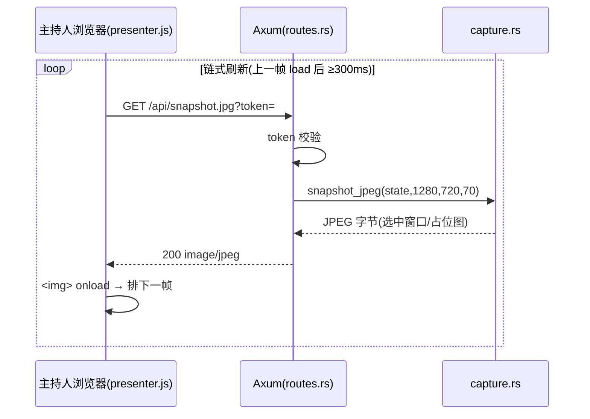
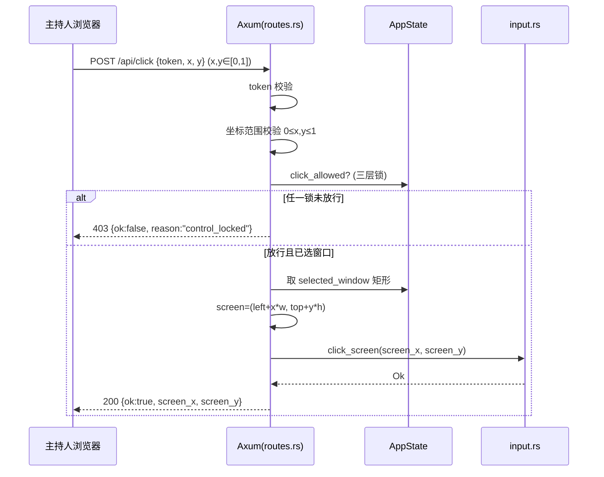

# StageDeck Remote 架构文档

> 本文描述**技术结构与关键决策**，是实现的设计依据。需求与产品范围见
> [`project.md`](project.md)，本文不重复需求，只在必要处引用其章节（如 §11）。
> 决策的"为什么"沉淀在 [`adr/`](adr/) 下的决策记录中。
>
> 状态：MVP 脚手架阶段。原生截图/输入/窗口枚举为 `TODO(windows)` 占位。

---

## 1. 背景与范围

StageDeck Remote 让主持人通过**手机/平板浏览器**看到导播电脑上的 PowerPoint 放映画面，
并以**受限、可被导播随时接管**的方式点击 PPT 按钮、翻页。它不是远程桌面，而是一个
受限的舞台控制面板。完整动机见 [`project.md`](project.md) §1–§3。

本文覆盖：组件划分与信任边界、运行时数据流、状态模型、坐标映射、模块职责、
平台/构建策略、安全模型。

---

## 2. 系统上下文

```
┌─────────────────┐        5GHz Wi-Fi        ┌──────────────────────────────┐
│ 主持人 手机/平板 │ ───────────────────────▶ │           导播电脑            │
│  浏览器(无需安装) │ ◀─────────────────────── │                              │
└─────────────────┘     HTTP/WS :8787         │  ┌────────────────────────┐  │
                                              │  │  StageDeck Remote(本应用) │  │
                                              │  └──────────┬─────────────┘  │
                                              │   模拟点击/键盘 ▼  ▲ 截图     │
                                              │      ┌──────────────────┐    │
                                              │      │ PowerPoint 放映窗口 │    │
                                              │      └─────────┬────────┘    │
                                              │         OBS 捕捉 ▼ HDMI       │
                                              │                ▼ 舞台屏幕      │
                                              └──────────────────────────────┘
```

- 网络自带、不依赖场馆 Wi-Fi；导播电脑有线、固定 IP；详见 [`project.md`](project.md) §8。
- 主持人设备零安装，扫码即用。决策见 [ADR-0003](adr/0003-presenter-vanilla-js.md)。

---

## 3. 组件与信任边界

应用进程内有两条对外通道，分别对应**两个信任级别**——这是本架构的核心。

```
        本机、特权                                局域网、受限
┌──────────────────────┐                ┌────────────────────────┐
│   导播 GUI (Vue 3)    │                │   主持人页 (原生 JS)     │
│  WindowPicker / 本地  │                │  预览图 + 大按钮         │
│  控制 / 状态 / 日志    │                │                        │
└───────────┬──────────┘                └────────────┬───────────┘
            │ Tauri IPC                               │ HTTP/WS (token)
            │ (commands.rs)                           │ (routes.rs)
            ▼                                         ▼
   ┌───────────────────────────────────────────────────────────┐
   │                  Rust 核心 (src-tauri)                      │
   │   ┌─────────────────────┐     ┌─────────────────────────┐  │
   │   │ commands.rs(特权)    │     │ web_server.rs + routes.rs│  │
   │   │ 枚举/选窗、远程开关、 │     │ Axum :8787 主持人 API     │  │
   │   │ 强制锁、本地翻页      │     └────────────┬────────────┘  │
   │   └──────────┬──────────┘                  │               │
   │              └───────────┬──────────────────┘               │
   │                          ▼  共享 Arc<AppState>(Mutex)        │
   │     window_manager · capture · input · obs · network ·      │
   │                 auth · config · log                         │
   └───────────────────────────────────────────────────────────┘
```

**为什么分两条通道**（详见 [ADR-0002](adr/0002-ipc-http-trust-boundary.md)）：

- **导播特权操作走 Tauri IPC**：枚举/选择窗口、开关远程、强制锁、本地兜底翻页。
  这些只在本机进程内调用，**不监听网络端口、不可能被局域网访问**。
- **主持人能力走 Axum HTTP**：看画面、点击、翻页、本地锁。这是**唯一对局域网暴露**的面，
  且每个请求都要 token。
- 结果：网络上能看到的接口 = 主持人被允许做的事；导播的"上帝权限"天然不在攻击面里。
  这直接落地了 [`project.md`](project.md) §13 的安全意图。

**Axum 层与 Tauri 解耦**：`web_server.rs` / `routes.rs` 只依赖 `Arc<AppState>`，不引用 `tauri`。
好处是可在非 Windows、无 Tauri GUI 依赖（webkit2gtk）的环境单独编译/检查服务层。
见 [ADR-0004](adr/0004-cfg-windows-native.md) 与 [`build-environment`]。

---

## 4. 运行时数据流

### 4.1 截图推送（MVP：HTTP 轮询）



MVP 用轮询；后续可升级 WebSocket/MJPEG（见 [`project.md`](project.md) §9.3）。
前端用**链式刷新**而非定时器，避免慢链路下请求堆积。

### 4.2 远程点击（归一化坐标 → 屏幕点击）



坐标映射公式见 §6。失败原因码见 [`project.md`](project.md) §9.4。

### 4.3 翻页 / 锁定

- `POST /api/next|/prev` → 要求 `button_allowed`（远程开 且 未强制锁）→ `input::key_next/prev`。
- `POST /api/unlock` → 仅当 `button_allowed` 时置 `presenter_unlocked=true`；`/api/lock` 置回 false。
- 翻页**不要求**主持人解锁（显式按钮意图明确）；点击预览图**要求**解锁（防误触）。

### 4.4 导播端（IPC）

导播 GUI 每 1.5s 调 `get_status` + `get_logs` 轮询刷新；操作（开关远程/强制锁/选窗）
调对应 command 后立即再刷新一次。导播操作不经网络。

---

## 5. 状态模型

全局状态 `AppState { inner: Mutex<Inner> }`，以 `Arc<AppState>` 同时交给
Tauri（`.manage()`）与 Axum（`.with_state()`）两条通道共享。`Inner` 关键字段：

| 字段 | 初值 | 含义 |
| --- | --- | --- |
| `selected_window` | `None` | 目标 PPT 窗口（标题/矩形/句柄） |
| `remote_enabled` | `false` | 导播总开关（锁层 1） |
| `control_locked` | `true` | 导播强制锁（锁层 2） |
| `presenter_unlocked` | `false` | 主持人本地解锁（锁层 3） |
| `active_client_id` | `None` | 当前控制端（单控制者，P1 强化） |
| `token` | 启动随机生成 | 访问鉴权 |
| `server_port` | `8787` | 服务端口 |
| `logs` | `[]` | 事件环形缓冲(≤500) |

**三层锁**（[`project.md`](project.md) §13.2）：

- 点击预览图（隐式操作）：`click_allowed = remote_enabled && !control_locked && presenter_unlocked`
- 显式按钮（翻页等）：`button_allowed = remote_enabled && !control_locked`

默认最安全：远程关、强制锁、未解锁。导播显式开启后才可控。关闭远程或强制锁会同时
清掉 `presenter_unlocked`，确保彻底接管。

> 并发：`Inner` 用 `std::sync::Mutex`，临界区短、不跨 `.await` 持锁。

---

## 6. 坐标系与映射

主持人端**永远发送归一化坐标** `{x,y}∈[0,1]`，不发设备像素（设备尺寸/缩放各异）。
后端读取目标窗口矩形 `(left, top, width, height)` 后映射：

```
screen_x = left + round(x * width)
screen_y = top  + round(y * height)
```

后端强制校验 `0≤x,y≤1`，越界拒绝（`coordinate_out_of_range`）。
风险（DPI 缩放、窗口失焦、鼠标可见）见 [`project.md`](project.md) §18。

---

## 7. 模块职责映射

`src-tauri/src/`（详细职责见 [`project.md`](project.md) §11）：

| 模块 | 职责 | 通道 / 平台 |
| --- | --- | --- |
| `lib.rs` | 启动：生成 token、初始化状态、spawn Axum、注册命令、运行 Tauri | — |
| `main.rs` | 二进制入口（release 隐藏控制台） | — |
| `commands.rs` | 导播端**特权 IPC** 命令 | Tauri IPC |
| `app_state.rs` | `AppState` / `Inner` / `TargetWindow` / 锁判定 | 共享 |
| `web_server.rs` | 启动 Axum，绑定 `0.0.0.0:8787` | HTTP |
| `routes.rs` | 主持人**受限 HTTP API**（§9 全端点） | HTTP |
| `auth.rs` | token 生成 / 校验 | 共享 |
| `window_manager.rs` | 枚举/识别/矩形/置前 | `#[cfg(windows)]` |
| `capture.rs` | 窗口截图 → JPEG（当前占位图） | `#[cfg(windows)]` |
| `input.rs` | 模拟鼠标/键盘 | `#[cfg(windows)]` |
| `obs.rs` | OBS WebSocket 黑屏/恢复（P2 占位） | — |
| `network.rs` | 局域网 IP 发现、访问 URL | 共享 |
| `config.rs` | 配置持久化 | 共享 |
| `log.rs` | 事件日志（内存环形 + stdout） | 共享 |

前端 `src/`：`views/DirectorView.vue` 主面板组合 `components/*`，经 `stores/`(Pinia) 持有状态，
`utils/api.ts` 封装 IPC；`presenter/` 是独立的原生 JS 页面，由 Axum 直接 serve。

---

## 8. 平台与构建策略

- **目标平台 Windows**：截图/输入/窗口枚举依赖 Win32（`windows-rs`）。
- **跨平台编译**：原生能力放 `#[cfg(windows)]` 真实分支 + `#[cfg(not(windows))]` 占位分支
  （截图返回占位图、输入返回"不支持"），使**服务层在 Linux/macOS 也能编译**，便于开发期
  联调与 CI 检查。见 [ADR-0004](adr/0004-cfg-windows-native.md)。
- **构建注意**：Linux 上构建完整 Tauri 应用还需系统库 `webkit2gtk`/`librsvg`；生产构建建议
  在 Windows 上 `pnpm tauri dev` / `tauri build`。开发机限制见记忆 [`build-environment`]。
- **验证手段**：前端 `pnpm typecheck` + `vite build`；服务层在隔离 crate 中 `cargo check`
  （排除 Tauri 胶水）；`presenter.js` 用 `node --check` 校语法。

---

## 9. 安全模型

| 机制 | 实现 | 对应需求 |
| --- | --- | --- |
| Token 鉴权 | 所有主持人接口校验 token；启动随机生成 | §13.1 |
| 三层锁 | `remote_enabled` / `control_locked` / `presenter_unlocked` | §13.2 |
| 坐标校验 | 后端强制 `0≤x,y≤1`，越界拒绝 | §13.3 |
| 信任边界 | 导播特权走 IPC，不上网；网络只暴露主持人面 | §13（强化） |
| 单控制端 | `active_client_id`（MVP 记录，P1 强制独占） | §13.4 |
| 审计日志 | 关键操作记时间/坐标/结果到 `log.rs` | §13.5 |
| 断线保护 | 主持人端掉线即视为锁定、禁用按钮、遮罩提示 | §12.2 |

---

## 10. 已知占位与待办

| 项 | 现状 | 去向 |
| --- | --- | --- |
| `window_manager` 枚举/识别 | 空占位 | `TODO(windows)`：EnumWindows 等 |
| `capture` 真实截图 | 返回占位图 | `TODO(windows)`：PrintWindow/BitBlt |
| `input` 模拟点击/按键 | windows 下空实现 | `TODO(windows)`：SendInput |
| OBS 黑屏/恢复 | 返回 not_implemented | P2：obws WebSocket |
| 二维码 | 文本占位 | 接入离线 `qrcode` 库 |
| 截图传输 | HTTP 轮询 | P1+：WebSocket/MJPEG |
| 单控制端独占 | 仅记录 | P1：抢占/踢出逻辑 |

打通最短闭环的实现顺序（[`project.md`](project.md) §19）：
`window_manager` → `capture` → `input`，即可实现"手机点击 → PPT 真实点击"。

---

## 关联文档

- 需求与产品范围：[`project.md`](project.md)
- 决策记录：[`adr/`](adr/)
- 网络部署：[`network.md`](network.md) ｜ 协议：[`protocol.md`](protocol.md) ｜ 彩排：[`rehearsal-checklist.md`](rehearsal-checklist.md)
