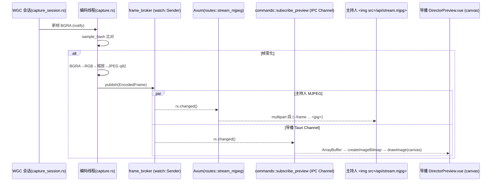
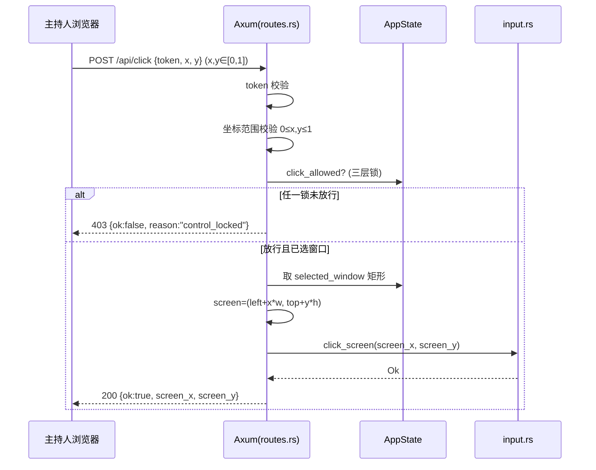

# StageDeck Remote 架构文档

> 本文描述**技术结构与关键决策**，是实现的设计依据。需求与产品范围见
> [`project.md`](project.md)，本文不重复需求，只在必要处引用其章节（如 §11）。
> 决策的"为什么"沉淀在 [`adr/`](adr/) 下的决策记录中。
>
> 状态：核心闭环已实现并演进至 v0.2.0。原生截图/输入/窗口枚举 + PowerPoint COM 控制均为
> `#[cfg(windows)]` 真实分支（非 Windows 为占位 stub），源码已无 `TODO(windows)` 标记。
> 截图链路在 v0.1.16 从 HTTP 轮询升级为"变化驱动 + 单点编码 + MJPEG/Channel 推送"（§4.1）；
> v0.2.0 引入 CLAB Relay 作为 LAN 之外的可选传输路径（§11）。

---

## 1. 背景与范围

StageDeck Remote 让主持人通过**手机/平板浏览器**看到导播电脑上的 PowerPoint 放映画面，
并以**受限、可被导播随时接管**的方式点击 PPT 按钮、翻页。它不是远程桌面，而是一个
受限的舞台控制面板。完整动机见 [`project.md`](project.md) §1–§3。

本文覆盖：组件划分与信任边界、运行时数据流、状态模型、坐标映射、模块职责、
平台/构建策略、安全模型。

---

## 2. 系统上下文

```
┌─────────────────┐        5GHz Wi-Fi        ┌──────────────────────────────┐
│ 主持人 手机/平板 │ ───────────────────────▶ │           导播电脑            │
│  浏览器(无需安装) │ ◀─────────────────────── │                              │
└─────────────────┘     HTTP/WS :8787         │  ┌────────────────────────┐  │
                                              │  │  StageDeck Remote(本应用) │  │
                                              │  └──────────┬─────────────┘  │
                                              │   模拟点击/键盘 ▼  ▲ 截图     │
                                              │      ┌──────────────────┐    │
                                              │      │ PowerPoint 放映窗口 │    │
                                              │      └─────────┬────────┘    │
                                              │            HDMI ▼             │
                                              │                ▼ 舞台屏幕      │
                                              └──────────────────────────────┘
```

- 网络自带、不依赖场馆 Wi-Fi；导播电脑有线、固定 IP；详见 [`project.md`](project.md) §8。
- 主持人设备零安装，扫码即用。决策见 [ADR-0003](adr/0003-presenter-vanilla-js.md)。

---

## 3. 组件与信任边界

应用进程内有两条对外通道，分别对应**两个信任级别**——这是本架构的核心。

```
        本机、特权                                局域网、受限
┌──────────────────────┐                ┌────────────────────────┐
│   导播 GUI (Vue 3)    │                │   主持人页 (原生 JS)     │
│  WindowPicker / 本地  │                │  预览图 + 大按钮         │
│  控制 / 状态 / 日志    │                │                        │
└───────────┬──────────┘                └────────────┬───────────┘
            │ Tauri IPC                               │ HTTP/WS (token)
            │ (commands.rs)                           │ (routes.rs)
            ▼                                         ▼
   ┌───────────────────────────────────────────────────────────┐
   │                  Rust 核心 (src-tauri)                      │
   │   ┌─────────────────────┐     ┌─────────────────────────┐  │
   │   │ commands.rs(特权)    │     │ web_server.rs + routes.rs│  │
   │   │ 枚举/选窗、远程开关、 │     │ Axum :8787 主持人 API     │  │
   │   │ 强制锁、本地翻页      │     └────────────┬────────────┘  │
   │   └──────────┬──────────┘                  │               │
   │              └───────────┬──────────────────┘               │
   │                          ▼  共享 Arc<AppState>(Mutex)        │
   │   window_manager · capture · capture_session · input ·      │
   │   ppt_com · network · auth · config · presets · log         │
   └───────────────────────────────────────────────────────────┘
```

**为什么分两条通道**（详见 [ADR-0002](adr/0002-ipc-http-trust-boundary.md)）：

- **导播特权操作走 Tauri IPC**：枚举/选择窗口、开关远程、强制锁、本地兜底翻页。
  这些只在本机进程内调用，**不监听网络端口、不可能被局域网访问**。
- **主持人能力走 Axum HTTP**：看画面、点击、翻页、本地锁。这是**唯一对局域网暴露**的面，
  且每个请求都要 token。
- 结果：网络上能看到的接口 = 主持人被允许做的事；导播的"上帝权限"天然不在攻击面里。
  这直接落地了 [`project.md`](project.md) §13 的安全意图。

**Axum 层与 Tauri 解耦**：`web_server.rs` / `routes.rs` 只依赖 `Arc<AppState>`，不引用 `tauri`。
好处是可在非 Windows、无 Tauri GUI 依赖（webkit2gtk）的环境单独编译/检查服务层。
见 [ADR-0004](adr/0004-cfg-windows-native.md) 与 [`build-environment`]。

---

## 4. 运行时数据流

### 4.1 截图推送（变化驱动 + 单点编码 + 双向推送）

WGC 后台会话把原始 BGRA 帧写入共享缓冲；编码线程对原始缓冲做**采样 hash** 检测变化，
**变化才编码一次**（JPEG q82）并 publish 到 `frame_broker`（`tokio::sync::watch` 扇出）。
两条消费链路各自订阅 broker，不重复编码：



- **主持人端**：单根长连 `GET /api/stream.mjpg`（`multipart/x-mixed-replace`），浏览器原生换帧、空闲零流量。
  `snapshot.jpg` 保留为一次性兜底。
- **导播端**：`subscribe_preview` IPC 用 Tauri `Channel<tauri::ipc::Response>` 推**原始 JPEG 字节**到 webview，
  绕开 webview 拉环回 HTTP 的 PNA 阻断；前端 `createImageBitmap` → `<canvas>` 双缓冲。`get_snapshot` IPC 保留为兜底。
- WGC 不可用退 BitBlt 定时抓取兜底；空闲时（无帧或采样 hash 一致）**≈零 CPU**。
- 完整设计见 [ADR-0006](adr/0006-capture-stream-broker.md) 与 spec
  [`superpowers/specs/2026-06-16-capture-stream-optimization-design.md`](superpowers/specs/2026-06-16-capture-stream-optimization-design.md)。

### 4.2 远程点击（归一化坐标 → 屏幕点击）



坐标映射公式见 §6。失败原因码见 [`project.md`](project.md) §9.4。

### 4.3 翻页 / 锁定

- `POST /api/next|/prev` → 要求 `click_allowed`（三层全通，含主持人 ARM）→ `ppt_com::nav_next/prev`，
  COM 失败回退 `input::key_next/prev`。
- `POST /api/black|/restore` → 同样要求 `click_allowed` → `ppt_com::set_black(true/false)`。
- `POST /api/action` → 要求 `click_allowed` → `ppt_com::trigger_action(shape)`（运行宏）。
- `POST /api/unlock` → 仅当 `button_allowed`（远程开且未紧急锁）时置 `presenter_unlocked=true`，
  即主持人 ARM；`/api/lock` 置回 false。
- **所有**主持人动作（翻页/黑屏/恢复/宏/点击预览图）都要求 `click_allowed`；
  `button_allowed` 仅作为主持人能 ARM 的前置门控。

### 4.4 导播端（IPC）

导播 GUI 每 1.5s 调 `get_status` + `get_logs` 轮询刷新；操作（开关远程/强制锁/选窗）
调对应 command 后立即再刷新一次。**预览帧不在这条轮询里**——由 `subscribe_preview` 经 Tauri Channel
由 broker 在变化时推送（§4.1）。导播操作不经网络。

---

## 5. 状态模型

全局状态 `AppState { inner: Mutex<Inner> }`，以 `Arc<AppState>` 同时交给
Tauri（`.manage()`）与 Axum（`.with_state()`）两条通道共享。`Inner` 关键字段：

| 字段 | 初值 | 含义 |
| --- | --- | --- |
| `selected_window` | `None` | 目标 PPT 窗口（标题/矩形/句柄） |
| `remote_enabled` | `false` | 导播总开关（锁层 1） |
| `control_locked` | `false` | 导播紧急锁（锁层 2，仅紧急用） |
| `presenter_unlocked` | `false` | 主持人本地解锁（锁层 3） |
| `active_client_id` | `None` | 当前控制端（单控制者，P1 强化） |
| `token` | 启动随机生成 | 访问鉴权 |
| `server_port` | `8787` | 服务端口 |
| `logs` | `[]` | 事件环形缓冲(≤500) |

**三层锁**（[`project.md`](project.md) §13.2）：

- **所有主持人动作**（翻页/黑屏/恢复/宏/点击预览图）：
  `click_allowed = remote_enabled && !control_locked && presenter_unlocked`
- **主持人 ARM 的前置门控**（`/api/unlock`）：`button_allowed = remote_enabled && !control_locked`

默认：远程关、紧急锁释放（仅紧急用）、未 ARM。导播开「远程控制」一步即放行 `button_allowed`，
主持人再 ARM（`/api/unlock`）即得全功能。关闭远程或触发紧急锁会同时清掉 `presenter_unlocked`，
确保彻底接管。

> 并发：`Inner` 用 `std::sync::Mutex`，临界区短、不跨 `.await` 持锁。

---

## 6. 坐标系与映射

主持人端**永远发送归一化坐标** `{x,y}∈[0,1]`，不发设备像素（设备尺寸/缩放各异）。
后端读取目标窗口矩形 `(left, top, width, height)` 后映射：

```
screen_x = left + round(x * width)
screen_y = top  + round(y * height)
```

后端强制校验 `0≤x,y≤1`，越界拒绝（`coordinate_out_of_range`）。
风险（DPI 缩放、窗口失焦、鼠标可见）见 [`project.md`](project.md) §18。

---

## 7. 模块职责映射

`src-tauri/src/`（详细职责见 [`project.md`](project.md) §11）：

| 模块 | 职责 | 通道 / 平台 |
| --- | --- | --- |
| `lib.rs` | 启动：生成 token、初始化状态、spawn Axum、注册命令、运行 Tauri | — |
| `main.rs` | 二进制入口（release 隐藏控制台） | — |
| `commands.rs` | 导播端**特权 IPC** 命令 | Tauri IPC |
| `app_state.rs` | `AppState` / `Inner` / `TargetWindow` / 锁判定 | 共享 |
| `web_server.rs` | 启动 Axum，绑定 `0.0.0.0:8787` | HTTP |
| `routes.rs` | 主持人**受限 HTTP API**（§9 全端点） | HTTP |
| `auth.rs` | token 生成 / 校验 | 共享 |
| `window_manager.rs` | EnumWindows 枚举/识别/矩形/置前 | `#[cfg(windows)]` |
| `capture.rs` | WGC/BitBlt 帧来源 + 单点编码线程喂 broker；`snapshot_jpeg` 保留作一次性兜底 | `#[cfg(windows)]` 真分支 |
| `capture_session.rs` | WGC 后台捕获会话（写原始 BGRA 缓冲 + 通知编码线程） | `#[cfg(windows)]` |
| `frame_broker.rs` | `watch` 扇出已编码帧；`sample_hash` 变化检测；`mjpeg_part` 公共分帧 | 共享 |
| `input.rs` | SendInput 模拟鼠标/键盘 | `#[cfg(windows)]` |
| `ppt_com.rs` | PowerPoint COM 控制：翻页 / 黑屏-恢复 / 取放映态 / 运行宏 | `#[cfg(windows)]` |
| `relay_client.rs` | Relay 模式下的 WS 控制隧道 + WS 推流 + 重连 + token push（§11） | 共享 |
| `network.rs` | 局域网 IP 发现、访问 URL | 共享 |
| `config.rs` | 配置持久化（端口、Relay 配置） | 共享 |
| `presets.rs` | 预制快捷消息默认种子 + 持久化 | 共享 |
| `log.rs` | 事件日志（内存环形 + stdout） | 共享 |

前端 `src/`：`views/DirectorView.vue` 主面板组合 `components/*`，经 `stores/`(Pinia) 持有状态，
`utils/api.ts` 封装 IPC；`presenter/` 是独立的原生 JS 页面，由 Axum 直接 serve。

---

## 8. 平台与构建策略

- **目标平台 Windows**：截图/输入/窗口枚举依赖 Win32（`windows-rs`）。
- **跨平台编译**：原生能力放 `#[cfg(windows)]` 真实分支 + `#[cfg(not(windows))]` 占位分支
  （截图返回占位图、输入返回"不支持"），使**服务层在 Linux/macOS 也能编译**，便于开发期
  联调与 CI 检查。见 [ADR-0004](adr/0004-cfg-windows-native.md)。
- **构建注意**：Linux 上构建完整 Tauri 应用还需系统库 `webkit2gtk`/`librsvg`；生产构建建议
  在 Windows 上 `pnpm tauri dev` / `tauri build`。开发机限制见记忆 [`build-environment`]。
- **验证手段**：前端 `pnpm typecheck` + `vite build`；服务层在隔离 crate 中 `cargo check`
  （排除 Tauri 胶水）；`presenter.js` 用 `node --check` 校语法。

---

## 9. 安全模型

| 机制 | 实现 | 对应需求 |
| --- | --- | --- |
| Token 鉴权 | 所有主持人接口校验 token；启动随机生成 | §13.1 |
| 三层锁 | `remote_enabled` / `control_locked` / `presenter_unlocked` | §13.2 |
| 坐标校验 | 后端强制 `0≤x,y≤1`，越界拒绝 | §13.3 |
| 信任边界 | 导播特权走 IPC，不上网；网络只暴露主持人面 | §13（强化） |
| 单控制端 | `active_client_id` + `cid` 心跳强制独占：所有动作端点经 `is_controller` 门控，控制端离线（>4s 无心跳）才可被接管 | §13.4 |
| 审计日志 | 关键操作记时间/坐标/结果到 `log.rs` | §13.5 |
| 断线保护 | 主持人端掉线即视为锁定、禁用按钮、遮罩提示 | §12.2 |

---

## 10. 实现状态

| 项 | 现状 |
| --- | --- |
| `window_manager` 枚举/识别 | ✅ 已实现（EnumWindows + 类名/标题识别 + 矩形/置前） |
| `capture` 真实截图 | ✅ 已实现（WGC 最新帧 / GDI BitBlt 回退；未选窗时占位图） |
| `input` 模拟点击/按键 | ✅ 已实现（SendInput 绝对坐标点击 / 翻页按键） |
| 黑屏/恢复 | ✅ 已实现（PowerPoint COM `set_black`；原 OBS 方案已废弃） |
| 二维码 | ✅ 已实现（离线 `qrcode` 库本地渲染：`utils/qrcode.ts` + `QrCodePanel.vue`） |
| 单控制端独占 | ✅ 已实现（`note_presence_and_claim`：先到为主、控制端离线可被接管） |
| 截图传输 | ✅ 已实现（v0.1.16：变化驱动 + 单点编码 + MJPEG 推流；`snapshot.jpg` 保留兜底；§4.1） |
| Relay 传输路径 | ✅ 已实现（v0.2.0：CLAB 中继 + HTTP 隧道 + 二进制 WS 推流；LAN 仍并存；§11） |
| Relay session 宽限期回收 | 字段就位但后台清理任务未启用（已知 v1 限制；spec §13） |

PowerPoint 控制走**独立的 COM 通道**（`ppt_com.rs` 经 `GetActiveObject` 连到运行中的实例，
与被截窗口无关），不依赖前述 `input` 的窗口注入即可翻页/黑屏/运行宏；`input` 仅作 COM 失败时的回退。

---

## 11. Relay 模式（可选传输路径）

LAN 直连之外，可经一台**校园网内中继服务器**（部署在 PKU CLAB 等）让导播 PC 与主持人手机分别独立连上去——
为对付场馆 WiFi 的客户端隔离 / 对等阻断而设。**LAN 模式同时保留**；走哪条由二维码 URL 决定（手机无模式感知，
仍是相同的 HTML/JS 协议）。

```
[导播 Tauri / Windows]            [Relay / 校内 Linux]              [手机浏览器]
 - LAN Axum :8787 (留)             - Rust binary (axum 0.7)            扫码即用
 - relay_client.rs (新)     ──持久 WS 控制隧道──▶                    ──HTTP──▶
 - frame_broker (watch)     ──持久 WS 推流通道──▶                    ──MJPEG─▶
                                   - 会话表 + 隧道分发
                                   - watch 复刻一份扇出
```

**双平面**（详见 [ADR-0007](adr/0007-relay-hybrid-tunnel.md)）：

- **控制平面 = HTTP 隧道**：手机 `POST /r/<sid>/api/next?token=...` → relay 边缘校 token → 经常驻 WS 把
  `TunnelReq{req_id, method, path, headers, body_b64}` 推给导播；导播 `relay_client` 反序列化为
  `axum::http::Request`，**喂给现有 `routes::router()`**（`tower::ServiceExt::oneshot`）拿响应，原路回送。
  **`routes.rs` 业务零改动**；token/锁/cid/控制权判定仍在 director 内部。
- **推流平面 = 二进制 WS**：导播 `broker.subscribe()` 拿 `EncodedFrame.jpeg` 当 WS 二进制帧上送 relay；
  relay 复刻一份 `watch::Sender<Arc<Vec<u8>>>` 扇出给所有连本会话的手机，对手机吐 `/r/<sid>/api/stream.mjpg`——
  **手机端协议完全不变**（仍是 ``）。
- **会话**：导播 `ClientHello { session_id, token, secret, version }` 注册；session_id 短码 `[A-Z0-9-]{4,16}`；
  secret 防撞名。token 轮换 → 导播侧 push `TokenUpdate` 给 relay 更新缓存。
- **配置**：Settings 模态填 base_url / session_id / secret；改完**重启导播**生效。`QrCodePanel` 加 LAN/Relay 切换 toggle。
- **部署**：relay 是独立 Linux 二进制（`cargo build --release -p relay`），CLAB 上 systemd 跑，
  默认监听 `0.0.0.0:8080`。presenter 静态资源用 `include_str!` **编进 relay 二进制**——
  CLAB 不需要额外放前端文件；改 `src/presenter/*` 要同时重编**导播与 relay 两个二进制**。

### 11.1 Cargo workspace 结构

为共享 wire schema 引入 workspace：

```
StageDeckRemote/
├── Cargo.toml                  workspace 根
├── src-tauri/                  导播 Tauri 应用（+ 新增 relay_client.rs）
├── crates/
│   ├── protocol/               共享 wire types (ControlMessage, mjpeg_part)
│   └── relay/                  relay binary（lib + bin split：tests/ 能访问内部）
```

`relay` 是 lib+bin 双 target，便于集成测试 (`crates/relay/tests/end_to_end.rs`) 在 Linux loopback 上端到端跑通——
**不依赖 Windows / Tauri**，CI 可直接验。详见 spec
[`superpowers/specs/2026-06-25-relay-architecture-design.md`](superpowers/specs/2026-06-25-relay-architecture-design.md)。

---

## 关联文档

- 需求与产品范围：[`project.md`](project.md)
- 决策记录：[`adr/`](adr/)（含 ADR-0006 推流改造、ADR-0007 Relay）
- 网络部署：[`network.md`](network.md) ｜ 协议：[`protocol.md`](protocol.md) ｜ 彩排：[`rehearsal-checklist.md`](rehearsal-checklist.md)
